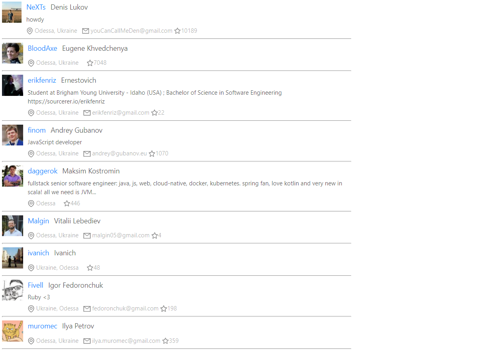

# GitHub Top Users

A React application that displays top GitHub users using the GitHub GraphQL API.



## Features

- Loads GitHub user data through GraphQL
- Displays user information in a responsive interface
- Manages application state with Redux
- Handles asynchronous flows with Redux-Saga
- Uses reusable components styled with Styled Components and Ant Design

## Tech stack

- React
- Redux and Redux-Saga
- GraphQL and Apollo
- Styled Components
- Ant Design
- JavaScript

## Getting started

### Prerequisites

- Node.js and Yarn
- A GitHub personal access token with only the permissions required to read public data

### Installation

```bash
git clone https://github.com/Zaratustra777/hub-users.git
cd hub-users
yarn install
```

Create a `.env.local` file in the project root:

```env
REACT_APP_GITHUB_TOKEN=your_github_token
```

Never commit your token to the repository.

Start the development server:

```bash
yarn start
```

Then open [http://localhost:3000](http://localhost:3000).

## Available scripts

- `yarn start` — run the development server
- `yarn test` — run tests
- `yarn build` — create a production build

## Author

[Alexander Bayanov](https://github.com/Zaratustra777) · [LinkedIn](https://www.linkedin.com/in/%D0%B0%D0%BB%D0%B5%D0%BA%D1%81%D0%B0%D0%BD%D0%B4%D1%80-%D0%B1%D0%B0%D1%8F%D0%BD%D0%BE%D0%B2-957b0266/)
